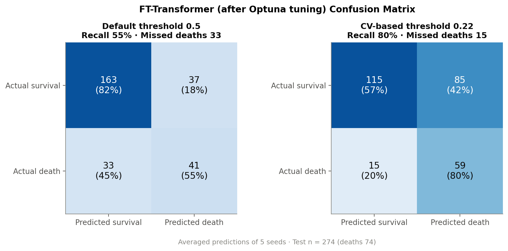
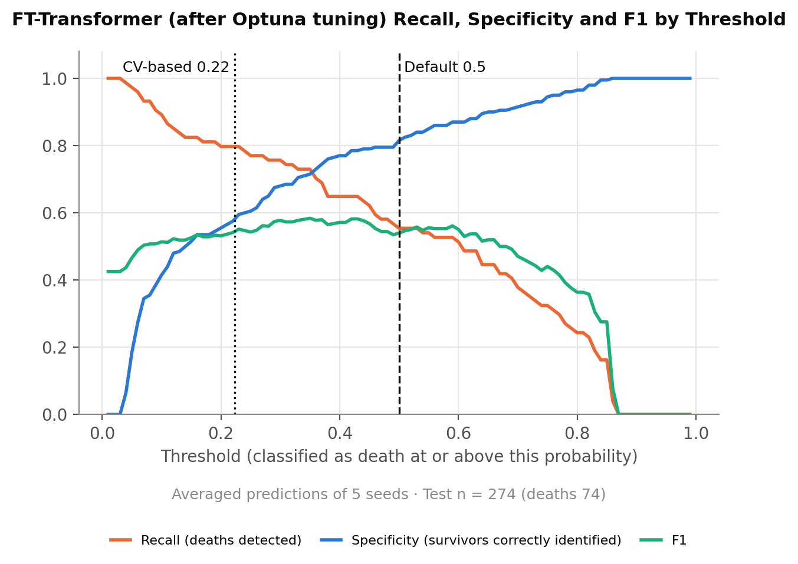
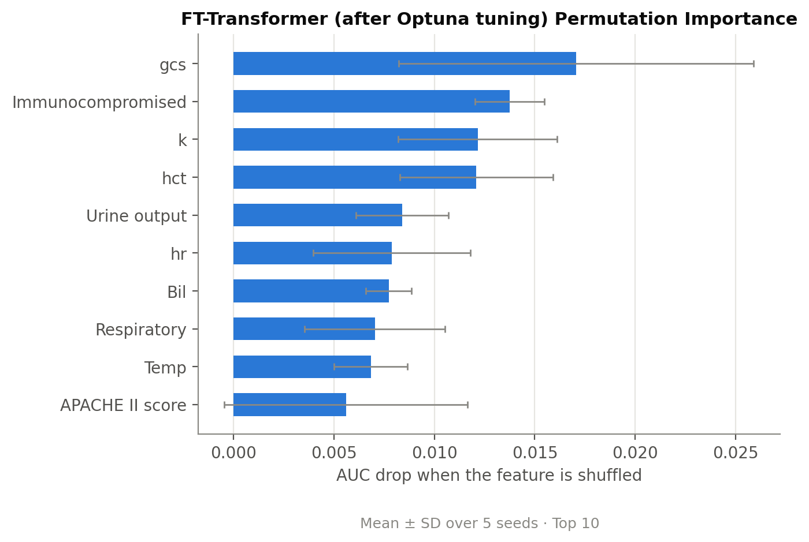
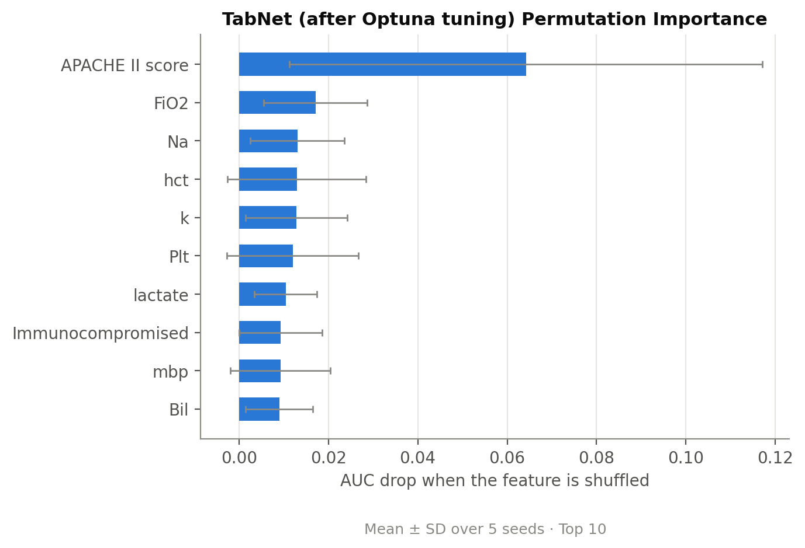

# Predicting Sepsis Mortality through Model Tuning and Threshold Analysis with PyTorch

Predicted death for ICU sepsis patients from their first 24 hours of data, then lowered the cutoff for flagging a patient as high risk so the model caught more of the patients who died (**recall 55% → 80%**).

- **Type:** Bootcamp team project (5 members), Jun 2025
- **My role:** Deep learning modeling (TabNet, FT-Transformer) and hyperparameter tuning
- **Tools:** Python, PyTorch, pytorch-tabnet, rtdl_revisiting_models, scikit-learn, Optuna
- **Portfolio page:** [link]
- **Presentation slides:** [link]

> **Data not included.** The patient data was provided by the training program and cannot be shared. This repository contains the code and result figures only.

---

## 1. Goal

Sepsis is a leading cause of death in intensive care units, making the early identification of high-risk patients critical. This project asked:

1. Can in-hospital mortality be predicted using only data from the first 24 hours?
2. How should the decision threshold be set to minimize missed deaths?
3. Which clinical variables contribute most to the model's predictions?

## 2. Data

- **Source:** provided by the Oracle Bio Data Analytics Bootcamp; the original source was not disclosed.
- **Not documented in the data:** the exact outcome definition (e.g., ICU or 28-day mortality) and preprocessing details (scaling and missing-value handling were done by a teammate).
- **Patients:** 911 (270 deaths, about 30%)
- **Variables:** 34 after the team's feature selection
  - 23 continuous variables, such as age, blood pressure, urine output and level of consciousness
  - 11 categorical (binary) variables, such as underlying conditions and mechanical ventilation
- **Split:** 637 patients for training and 274 for testing (74 deaths). The test set was used only for the final evaluation.

### Variables (34)

Continuous variables are the worst value during the first 24 hours after ICU admission. They were standardized (mean 0, SD 1) during the team's preprocessing, using the training set only. Names are shown as they appear in the data.

**Continuous variables (23)**

| Group | Variable | Description |
|---|---|---|
| Patient | `Age` | Age (years) |
| | `bmi` | Body mass index |
| Severity scores | `APACHE II score` | Acute Physiology and Chronic Health Evaluation II score |
| | `sofa` | Sequential Organ Failure Assessment score |
| | `gcs` | Glasgow Coma Scale (level of consciousness) |
| Vital signs | `mbp` | Mean blood pressure |
| | `hr` | Heart rate |
| | `rr` | Respiratory rate |
| | `Temp` | Body temperature |
| | `Urine output` | Urine output |
| Respiratory / blood gas | `FiO2` | Fraction of inspired oxygen |
| | `PaO2/FiO2` | Ratio of arterial oxygen to inspired oxygen |
| | `A-a gradient` | Alveolar–arterial oxygen gradient (how well the lungs transfer oxygen) |
| | `pco2` | Partial pressure of carbon dioxide |
| | `pH` | Arterial pH |
| | `lactate` | Lactate |
| Laboratory | `wbc` | White blood cell count |
| | `hct` | Hematocrit |
| | `Plt` | Platelet count |
| | `Na` | Sodium |
| | `k` | Potassium |
| | `Cr` | Creatinine |
| | `Bil` | Bilirubin |

**Categorical variables (11, binary: 1 = yes, 0 = no; `Sex` is coded 0/1)**

| Group | Variable | Description |
|---|---|---|
| Patient | `Sex` | Sex |
| Underlying conditions | `Heart` | Chronic heart disease |
| | `Respiratory` | Chronic respiratory disease |
| | `Renal` | Chronic kidney disease |
| | `liver` | Chronic liver disease |
| | `Immunocompromised` | Weakened immune system |
| Events in the first 24 hours | `arf` | Acute renal failure |
| | `multiorgan` | Multi-organ failure |
| | `AF_hos` | Atrial fibrillation during the hospital stay |
| Treatment | `mv` | Mechanical ventilation |
| | `vaso` | Vasopressor use |

Descriptions of the abbreviated categorical variables follow standard ICU terminology; the original data dictionary was not provided.

Outcome: death (1 = died, 0 = survived). The exact definition was not documented in the provided data.

## 3. Team scope

**Feature selection (team)**
- Stage 1: SHAP importance and VIF were used to drop variables that contributed little or overlapped with others (50 → 34 variables). **My models use these 34 variables.**
- Stage 2: variables that ranked low across several models were removed (34 → 29).
- Top five variables across the team's models: A-a gradient, PaO2/FiO2, APACHE II, lactate, urine output.

**Model comparison (team)**
The team compared 12 models and selected CatBoost as the best performer.
- Machine learning: SVM, XGBoost, LightGBM, CatBoost, Random Forest
- Deep learning: MLP, ResNet, TabNet, DANet, SAINT, FT-Transformer, TabPFN

**My part:** TabNet and FT-Transformer, each before and after tuning (the four scripts in this repository).

## 4. Method

**Models**
- **TabNet:** a deep learning model for tables that chooses which variables to look at in each step (`pytorch-tabnet`).
- **FT-Transformer:** applies the transformer architecture to tabular data. I used the official PyTorch implementation by the paper's authors (Gorishniy et al., 2021).

**How the 637 training patients were used**

The test set (274) was used only for the final evaluation. The 637 training patients were split differently at each stage:

| Stage | Trained on | Early stopping on | In the code |
|---|---|---|---|
| Final model (reported test results) | 509 (80%) | 128 (20%, fixed stratified split) | `train_test_split(..., test_size=0.2, random_state=42)` |
| Optuna tuning | 4 of 5 folds (~510) | the remaining fold (also the scored fold) | `objective()` |
| Decision threshold | 80% of 4 folds (~408) | 20% of 4 folds (~102) | `oof_probs()` |

The final model was not retrained on all 637 patients because early stopping needs held-out data. The 128-patient validation set is used only for early stopping.
**Training**
- Early stopping: max 200 epochs, stop after 20 epochs without improvement in validation AUC.
- Each model was trained with **five random seeds** (0–4). AUC is reported as the mean across seeds; threshold-based results use the **average of the five seeds' predictions**.
- Class imbalance: TabNet sampled deaths and survivors equally in each batch (`weights=1`); FT-Transformer used no class weighting. Both rely on the decision threshold below.

**Default settings (before tuning)**
- TabNet: pytorch-tabnet defaults (`n_d` 8, 3 steps, learning rate 0.02, batch size 1024).
- FT-Transformer: the default configuration from the paper (3 blocks, `d_block` 192, learning rate 1e-4), batch size 128.

**Tuning (Optuna)**
- 50 trials per model, set to keep tuning time manageable. The TPE sampler was used, and a median pruner stopped clearly worse trials early.
- Each setting was scored by stratified 5-fold cross-validation AUC on the 637 training patients; the test set was never used.
- Search space: TabNet (`n_d`, steps, gamma, sparsity penalty, learning rate, mask type, batch size); FT-Transformer (blocks, `d_block`, three dropout rates, learning rate, weight decay, batch size). See `objective()` in each script.
- Best 5-fold CV AUC: TabNet 0.815, FT-Transformer 0.841. These are slightly optimistic because early stopping used the scored fold, so they were used only to compare settings.
- The best settings are saved in each script (`BEST_PARAMS`), so the scripts reproduce the results without re-running Optuna.

**Decision threshold**
- The model outputs a probability of death. By default, patients at 0.5 or above are flagged as high risk, but because only about 30% of patients died, many of them scored below 0.5.
- I chose the threshold that maximizes F1 using **cross-validated (out-of-fold) predictions for all 637 training patients**.

**Metrics**

| Metric | Meaning |
|---|---|
| AUC | How well the model separates patients who died from those who survived (1.0 = perfect, 0.5 = chance) |
| Recall | Share of patients who died that the model flagged as high risk |
| Precision | Share of flagged patients who actually died |
| F1 | Balance of precision and recall |

**Variable importance**
- **Permutation importance:** shuffle one variable at a time on the test set and measure how much AUC drops.
- **TabNet mask importance:** the variable weights TabNet learns internally (TabNet only).

## 5. Results

Test set of 274 patients (74 deaths).

| Model | AUC | Recall @0.5 | Recall @CV | Precision @CV | F1 @CV |
|---|---|---|---|---|---|
| TabNet (before tuning) | 0.684 | 0.50 | 0.65 | 0.40 | 0.50 |
| TabNet (after tuning) | 0.702 | 0.53 | 0.72 | 0.51 | 0.60 |
| FT-Transformer (before tuning) | 0.754 | 0.45 | 0.74 | 0.44 | 0.56 |
| **FT-Transformer (after tuning)** | **0.771** | **0.55** | **0.80** | **0.41** | **0.54** |

@CV = cross-validated threshold.

### FT-Transformer separated patients better
Its AUC was higher than TabNet's (0.771 vs. 0.702), and tuning raised the AUC of both models by about 0.02. At the chosen threshold, however, tuned TabNet had a better balance of precision and recall (F1 0.60 vs. 0.54).

### At the default cutoff, nearly half of deaths were missed
The tuned FT-Transformer caught 55% of deaths at 0.5. With the cross-validated threshold (0.22), it caught 80%, and missed deaths fell from 33 to 15. In exchange, more survivors were flagged (37 → 85), and precision dropped from 53% to 41%.

<p align="center">
  
</p>

<p align="center">
  
</p>

### A threshold chosen on a small validation set was unstable
In the first version, the threshold was chosen on the 128-patient validation set (39 deaths). It ranged from 0.03 to 0.74 across seeds, and recall differed between two computers running the same code. Choosing it from cross-validated predictions for all 637 training patients and averaging the five seeds made the result consistent.

### The two models relied on different variables
- TabNet relied most on a severity score (APACHE II), which also ranked third in the team's feature selection. After tuning, APACHE II was first in both permutation importance (AUC drop 0.064, more than three times the next variable) and TabNet's own mask importance.
- FT-Transformer relied most on level of consciousness (Glasgow Coma Scale, GCS) and whether the patient had a weakened immune system. These two were the top two both before and after tuning.
- These are the variables the models used to make predictions, not proven causes of death.

<p align="center">
  
  
</p>

## 6. From prediction to decision

- **Who would use it:** ICU clinicians, to prioritize monitoring of high-risk patients on their first day.
- **What decision changes:** missing a high-risk patient is far more costly than an unnecessary alert, so the threshold matters as much as the model. Rather than reporting accuracy alone, I showed the trade-off between missed deaths and extra alerts and set the threshold based on it.

**Limitations**
- 911 patients from one undisclosed source; performance needs to be checked on data from other hospitals.
- Even with cross-validation, thresholds still varied between individual seeds (tuned FT-Transformer 0.16–0.52; for one seed of untuned TabNet, 0.03, which flagged every patient). Threshold results are therefore reported for the five-seed average. Per-seed results were lower and more variable: for the tuned FT-Transformer, recall at each seed's own threshold averaged 0.69 (SD 0.11) instead of 0.80.
- Real-world use would require agreeing with clinicians on an acceptable alert level.

## 7. How to run

```bash
pip install -r requirements.txt
# Put X_train.csv, X_test.csv, y_train.csv, y_test.csv in the same folder as the scripts
python tabnet_default.py
python tabnet_tuned.py
python ftt_default.py
python ftt_tuned.py
```

Each script saves its figures and result tables to `figures/<model name>/`.
The tuned scripts use the saved best settings by default (`RUN_OPTUNA = False`). Set `RUN_OPTUNA = True` to run the tuning again; only then are `06_optuna_history.png` and `optuna_trials.csv` created.

Note: results can differ slightly between computers because of PyTorch nondeterminism. AUC was stable; single-seed thresholds were not, which is why the five-seed average is reported.

## Repository structure

```
├── README.md
├── requirements.txt
├── tabnet_default.py       # TabNet, default settings
├── tabnet_tuned.py         # TabNet, tuned with Optuna
├── ftt_default.py          # FT-Transformer, default settings
├── ftt_tuned.py            # FT-Transformer, tuned with Optuna
└── figures/
    ├── TabNet_default/     # 01–05, 05b (mask importance), metrics CSVs
    ├── TabNet_tuned/
    ├── FTT_default/
    └── FTT_tuned/
```

Each `figures/<model name>/` folder contains:

| File | Content |
|---|---|
| `01_confusion_matrix.png` | Threshold 0.5 vs. cross-validated threshold |
| `02_roc_curve.png` | ROC curve |
| `03_probability_distribution.png` | Predicted probabilities for patients who died vs. survived |
| `04_threshold_curve.png` | Recall, specificity and F1 by threshold |
| `05_permutation_importance.png` / `.csv` | Top 10 variables by permutation importance |
| `05b_mask_importance.png` / `.csv` | TabNet only: mask importance |
| `06_optuna_history.png`, `optuna_trials.csv` | Tuned scripts only, when `RUN_OPTUNA = True`: tuning history |
| `metrics_by_seed.csv`, `metrics_summary.csv` | Test metrics per seed and averaged |

## Note on AI assistance

I used AI tools ([tool names]) for coding help to tidy the code. The modeling choices, threshold analysis and interpretation are my own.
